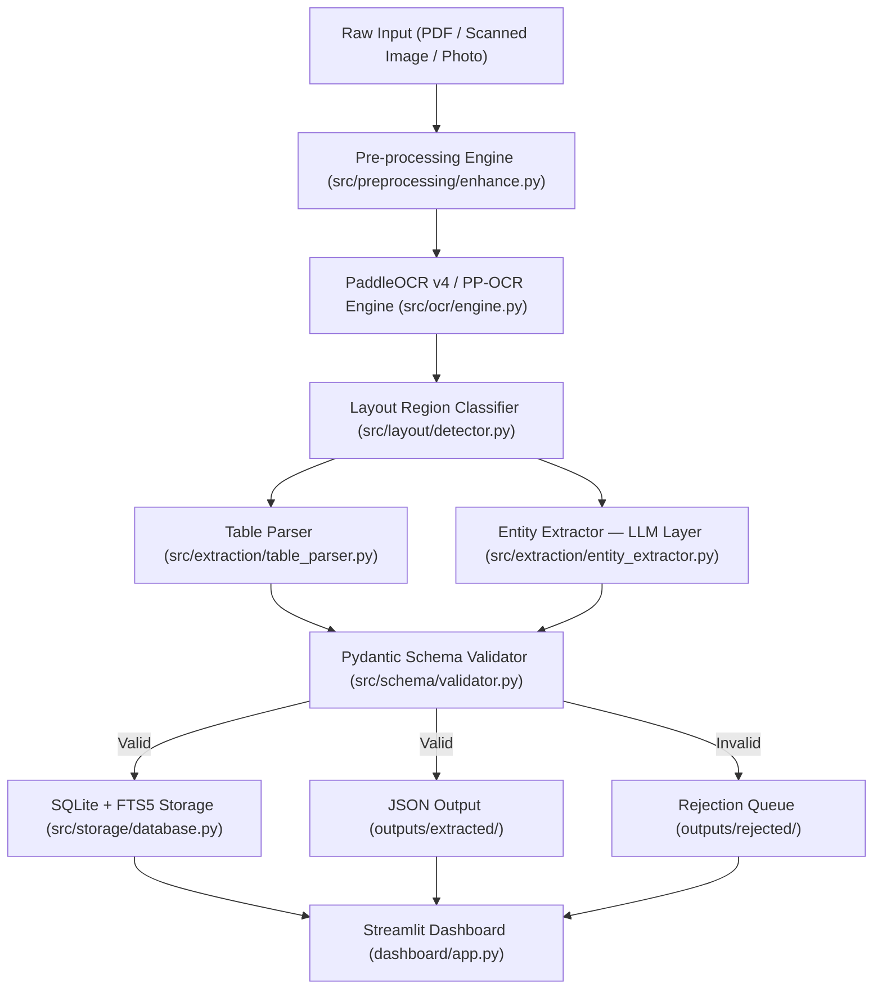

# MIDAS Architecture Guide

## System Overview

MIDAS (Multimodal Intelligent Document Analysis System) is an end-to-end document intelligence pipeline designed to ingest unstructured enterprise documents — supplier invoices, heavy equipment specifications, and quality/safety checklists — and transform them into structured, typed, and validated database records.

---

## Detailed Pipeline Stages

### Stage 1: Ingestion & Pre-processing Engine (`src/preprocessing/enhance.py`)
Real enterprise documents frequently arrive as mobile camera captures or multi-generation scans suffering from skew, dark lighting gradients, low contrast, and sensor noise.
- **Deskewing:** Employs Hough Line transform with length-filtering (>25% page width) to isolate dominant text baselines. Rotates the image back to true horizontal within ±15°.
- **Illumination Flattening:** Uses large-kernel morphological dilation and median blurring to estimate the uneven background lighting field, then normalizes the original image against this surface to eliminate flash glare and corner shadows.
- **Denoising:** Fast Non-Local Means algorithm removes high-frequency scanner grain and sensor artifacts.
- **Adaptive Binarization:** Local Gaussian thresholding produces crisp black-on-white text boundaries optimized for OCR detection.

### Stage 2: OCR Detection & Recognition (`src/ocr/engine.py`)
Utilizes PaddleOCR v4 (PP-OCRv4) architecture via ONNX Runtime:
- Direction Angle Classifier detects upside-down or sideways text lines.
- DBNet text detection accurately bounds multi-column layouts, condensed fonts, and rotated text.
- SVTR / CRNN sequence recognition transcribes character strings with confidence scores.
- Spatial sorting normalizes lines into natural top-to-bottom, left-to-right reading order.

### Stage 3: Layout Region Classifier (`src/layout/detector.py`)
Classifies document visual blocks into semantic zones:
- `Title` (prominent top headers)
- `Header` (metadata, dates, invoice numbers)
- `Table` (grid structures and cell matrices)
- `Text` / `Paragraph` (prose, instructions)
- `Footer` (bank details, sign-offs, legal terms)

By isolating tabular regions before passing text to the LLM, table cell contents are prevented from bleeding into continuous prose prompts.

### Stage 4: Table Parser (`src/extraction/table_parser.py`)
- **Digital Vector PDFs:** Directly parses drawing paths, text vectors, and cell borders via PyMuPDF vector extraction, preserving exact column alignments.
- **Scanned / Raster Images:** Utilizes OpenCV morphological line kernels to segment rows and columns, extracting clean 2D data matrices.

### Stage 5: Multimodal LLM Extraction Layer (`src/extraction/entity_extractor.py`)
- Takes both the raw OCR transcript and the classified layout region map.
- Formulates a structured prompt sent to Google Gemini Flash.
- Resolves abbreviations (`INV#`, `Qty`, `TIR`, `RMS`), typographical OCR slips, and fuzzy column headings.
- Includes a deterministic semantic fallback extractor that ensures reliable offline operation.
- Computes `_extraction_confidence` based on the fill rate of required contract fields.

### Stage 6: Pydantic Schema Validation (`src/schema/validator.py`)
- Enforces strict data models (`Invoice`, `TechnicalSpecification`, `InspectionReport`).
- Rejects malformed records (e.g. negative grand totals, specifications with 0 parameters).
- Performs arithmetic cross-checks on invoices (`grand_total == subtotal + tax_amount`).
- Routes failures to `outputs/rejected/` with diagnostic error traces.

### Stage 7: Storage & Search (`src/storage/database.py`)
- Persists all validated records to local SQLite database `outputs/midas.db`.
- FTS5 virtual table indexing enables sub-millisecond search across all parameters, vendor names, and checklist items.
